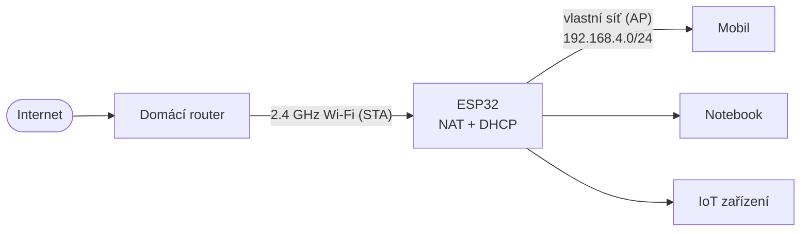

# ESP32 Wi-Fi NAT Router

[](LICENSE)
[](https://platformio.org)
[](https://arduino.cc)
[](https://github.com)

Miniaturní Wi-Fi NAT router postavený na platformě ESP32. Deska se připojí k vaší domácí Wi-Fi jako klient a sdílí toto připojení prostřednictvím vlastní sítě zabezpečené heslem. Součástí je dvonajazyčná (anglicko/česká) webová stránka pro snadné nastavení a sledování stavu v reálném čase.



## Vlastnosti

- **Směrování ve stylu opakovače (repeater):** Spouští režimy AP (přístupový bod) a STA (stanice) současně a aktivuje NAPT, jakmile domácí Wi-Fi přidělí ESP32 IP adresu.
- **Trvalé uložení nastavení:** Přihlašovací údaje k oběma sítím se ukládají do NVS (Non-Volatile Storage) a automaticky se načtou po každém restartu. Po prvním nastavení již není sériový monitor potřeba.
- **Webová správa:** Administrační stránka běžící na `http://192.168.4.1` zobrazuje aktuální počet připojených klientů, Wi-Fi kanál, uptime (dobu od spuštění) a volnou haldu paměti (free heap).
- **Dvojjazyčnost:** Volba mezi češtinou a angličtinou hned při prvním spuštění.
- **Vestavěný DHCP a DNS forwarding:** Klienti dostávají IP adresu automaticky a jako DNS server používají `1.1.1.1`, přičemž dotazy jsou předávány skrze NAPT.
- **Validace vstupů:** Podpora SSID o délce 1–32 UTF-8 bajtů a hesel o délce 8–63 bajtů.
- **Bezpečnost logování:** Hesla se nikdy nevypisují do sériového logu ani na stavovou webovou stránku.
- Podpora pro až čtyři současně připojené klienty.

## Podporované desky

| Deska | Výchozí prostředí v PlatformIO | Tlačítko BOOT |
| --- | --- | --- |
| ESP32 DevKit V1 (30 pinů) | `esp32-devkit-v1` | GPIO0 |

Pin tlačítka BOOT se definuje pomocí příznaku `-DBOOT_BUTTON_GPIO=...` v souboru [`platformio.ini`](platformio.ini). Pokud tento příznak chybí, firmware se automaticky vrátí k použití pinu GPIO9 (tlačítko na ESP32-C3).

Firmware byl původně napsán pro ESP32-C3, avšak pro tuto desku není kryt v rámci CI (Continuous Integration). Pokud jej chcete vyzkoušet na C3, přidejte do konfigurace prostředí:

```ini
[env:esp32-c3-devkitm-1]
board = esp32-c3-devkitm-1
build_flags =
    -DARDUINO_USB_MODE=1
    -DARDUINO_USB_CDC_ON_BOOT=1
    -DBOOT_BUTTON_GPIO=9
```

Projekt využívá framework Arduino specifikovaný přes verzi platformy `espressif32@8.0.0` (Arduino core 3.3.12), která nativně poskytuje API rozhraní `WiFi.AP.enableNAPT()`.

## Rychlý start

K nahrání budete potřebovat [PlatformIO](https://platformio.org) (buď jako rozšíření pro VS Code, nebo jako CLI nástroj) a USB **datový** kabel.

```sh
pio run                            # Sestavení projektu (build)
pio run --target uploadfilesystem  # Nahrání webových souborů ze složky public/
pio run --target upload            # Nahrání samotného firmwaru
pio device monitor -b 115200       # Spuštění sériového monitoru
```

*Poznámka: Pokud `platformio.ini` definuje více než jedno prostředí, přidejte ke každému příkazu přepínač `-e <název>` (např. `pio run -e esp32-devkit-v1`). Pokud váš systém nepodporuje cíl `uploadfilesystem`, použijte starší `uploadfs`.*

Příkaz pro nahrání souborového systému (`uploadfilesystem`) spusťte znovu pokaždé, když změníte HTML nebo CSS soubory ve složce `public/`. Firmware a souborový systém se do čipu nahrávají odděleně.

## První spuštění

1. Nahrajte souborový systém i firmware a otevřete sériový monitor.
2. Zvolte jazyk: zadejte `1` pro angličtinu nebo `2` pro češtinu.
3. Zadejte název (SSID) a heslo vaší domácí Wi-Fi. Pro otevřenou síť nechte heslo prázdné.
4. Zadejte název a heslo pro novou Wi-Fi síť, kterou bude vysílat samotné ESP32.
5. Připojte se s mobilem nebo počítačem na novou síť ESP a do prohlížeče zadejte `http://192.168.4.1`.
6. Jakmile ESP úspěšně získá IP adresu z domácího routeru, aktivuje se NAPT a připojení klienti budou online.

Při každém dalším restartu se konfigurace automaticky načte z NVS paměti a router naběhne sám.

## Změna nastavení

- **Přes webové rozhraní:** Otevřete v prohlížeči `http://192.168.4.1`, vyplňte nové údaje a zvolte **Uložit a restartovat**. Pokud chcete zachovat stávající heslo k domácí Wi-Fi, nechte pole hesla prázdné. Pokud chcete heslo úplně zrušit a udělat síť otevřenou, zaškrtněte příslušnou volbu pro otevřenou síť.
- **Přes sériový monitor:** Resetujte desku a stiskněte tlačítko **BOOT** do 3 sekund od spuštění (sériový monitor vás k tomu vyzve). Zařízení se vás znovu zeptá na konfiguraci obou sítí a uloží je. Tlačítko stiskněte až *po* resetu – držení tlačítka během resetu by čip přepnulo do bootloaderu pro nahrávání kódu. Pokud konfiguraci přes monitor přerušíte před uložením, původní nastavení v NVS zůstane zachováno.

Pokud přecházíte ze starší verze firmwaru, která podporovala pouze režim přístupového bodu, vaše nastavení sítě ESP, heslo i volba jazyka zůstanou zachovány a zařízení se vás pouze jednou zeptá na chybějící údaje k domácí Wi-Fi.

## Jak to funguje

- ESP32 běží v kombinovaném režimu `WIFI_AP_STA`. Podsíť pro správu je nastavena na `192.168.4.0/24` a samotné ESP má adresu `192.168.4.1`.
- Přístupový bod (AP) sice startuje na kanálu 1, ale následně se přizpůsobí kanálu domácího routeru. Čip má totiž pouze jedno sdílené Wi-Fi rádio.
- NAPT se zapíná automaticky při události `STA_GOT_IP` a vypíná se, pokud dojde ke ztrátě spojení. ESP se pokouší o opětovné připojení automaticky.
- Vysílací výkon je záměrně nastaven konzervativně na 8.5 dBm. Vyšší výkon nastavujte pouze s ohledem na požadované pokrytí a místní radiové regulace.

## Bezpečnostní upozornění

- Webová stránka pro správu není chráněna přihlašovacím jménem a heslem. Kdokoli, kdo je připojen k síti ESP, může nastavení změnit. Zvolte proto pro ESP síť silné heslo a nesdílejte ho s cizími lidmi.
- Přihlašovací údaje jsou v paměti NVS uloženy v nešifrované podobě. Osoba s fyzickým přístupem k desce by mohla data z flash paměti vyčíst.

Jedná se o hobby projekt určený k učení, nikoli o plnohodnotnou náhradu za komerční router.

## Omezení

- Podpora pouze pro pásmo 2.4 GHz. Jedno rádio obsluhuje obě rozhraní (příjem i vysílání), takže datová propustnost je znatelně nižší než u dedikovaných routerů a repeaterů.
- Váš domácí router již provádí NAT, takže toto řešení vytváří tzv. dvojitý NAT (Double NAT). Příchozí připojení, předávání portů (port forwarding) nebo některé online hry mohou vyžadovat dodatečné nastavení na hlavním domácím routeru.
- Maximálně 4 připojení klienti.
- Omezená kapacita paměti RAM – projekt je určen pro občasné připojení několika zařízení, nikoli pro permanentní vysokou zátěž.

## Řešení problémů (Troubleshooting)

| Problém | Co vyzkoušet |
| --- | --- |
| Příkaz `pio` nebyl rozpoznán | Přidejte cestu `%USERPROFILE%\.platformio\penv\Scripts` do systémové proměnné `PATH`, nebo ve VS Code otevřete **PlatformIO: New Terminal**. |
| Chyba `MissingPackageManifestError` | Stahování balíčku bylo přerušeno. Smažte poškozenou složku v `%USERPROFILE%\.platformio\packages` (tu, která neobsahuje `package.json`) a spusťte příkaz `pio pkg install` znovu. |
| Chyba `Failed to mount LittleFS` | Spusťte příkaz `pio run --target uploadfilesystem` (nebo `uploadfs`) pro opětovné nahrání webových souborů. |
| Deska se nehlásí jako COM port | Ujistěte se, že používáte datový USB kabel, a nainstalujte správný ovladač pro USB-UART převodník na vaší desce (nejčastěji CP210x nebo CH340). |
| Nahrávání visí na hlášce `Connecting...` | Jakmile se objeví výzva k připojování, stiskněte a podržte na desce tlačítko **BOOT** (případně IO0), dokud nahrávání nezačne. |
| VS Code se pokouší spustit CMake | Tento projekt nepoužívá CMake. Zakažte rozšíření *CMake Tools* pro tento konkrétní pracovní prostor (workspace). |

## Licence

MIT
