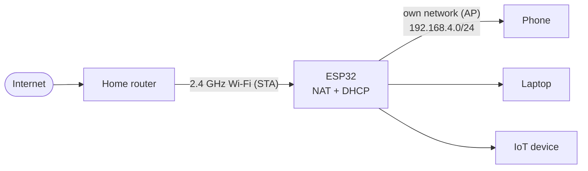

# ESP32 Wi-Fi NAT Router

[](LICENSE)
[](https://platformio.org/)
[](https://www.arduino.cc/)
[](https://github.com/Bloby22/esp32-wifi-nat-router/actions/workflows/build.yml)

A tiny Wi-Fi NAT router for the ESP32. The board joins your home
Wi-Fi as a client and shares that connection through its own password-protected
network, with a bilingual (English/Czech) web page for setup and live status.



## Features

- **Repeater-style routing:** runs AP and STA at the same time and enables NAPT
  as soon as the home Wi-Fi hands out an IP address.
- **Remembers its settings:** both networks' credentials are stored in NVS and
  reused after every restart. No serial monitor is needed after the first setup.
- **Web management page** at `http://192.168.4.1` with live client count, Wi-Fi
  channel, uptime, and free heap.
- **Bilingual:** English or Czech, chosen during the first setup.
- **Built-in DHCP and DNS forwarding:** clients get an address automatically and
  use `1.1.1.1` as DNS, forwarded through NAPT.
- **Input validation:** SSIDs are 1-32 UTF-8 bytes, passwords 8-63 bytes.
- **Passwords stay out of the serial log and the status page.**
- Up to four connected clients.

## Supported boards

| Board | PlatformIO environment | BOOT button |
| --- | --- | --- |
| ESP32 DevKit V1 (30-pin) | `esp32-devkit-v1` | GPIO0 |

The BOOT button pin is set with `-DBOOT_BUTTON_GPIO=...` in
[`platformio.ini`](platformio.ini); if the flag is missing, the firmware falls
back to GPIO9 (the ESP32-C3 button).

The firmware was originally written for the ESP32-C3 and is not covered by CI for
that board. To try it, add an environment such as:

```ini
[env:esp32-c3-devkitm-1]
board = esp32-c3-devkitm-1
build_flags =
    -DARDUINO_USB_MODE=1
    -DARDUINO_USB_CDC_ON_BOOT=1
    -DBOOT_BUTTON_GPIO=9
```

The project uses the Arduino framework, pinned through `espressif32@8.0.0`
(Arduino core 3.3.12), which provides the `WiFi.AP.enableNAPT()` API.

## Quick start

You need [PlatformIO](https://platformio.org/) (the VS Code extension or the
CLI) and a USB **data** cable.

```sh
pio run                      # build
pio run --target uploadfs    # upload web files from public/
pio run --target upload      # upload firmware
pio device monitor -b 115200 # serial monitor
```

If `platformio.ini` defines more than one environment, add `-e <name>` to each
command (for example `pio run -e esp32-devkit-v1`).

Run `uploadfs` again whenever you change the HTML or CSS in `public/`. Firmware
and filesystem images are uploaded separately.

## First startup

1. Upload the filesystem and firmware, then open the serial monitor.
2. Select English (`1`) or Czech (`2`).
3. Enter the home Wi-Fi name and password. Leave the password empty for an open
   network.
4. Enter the name and password for the ESP's own Wi-Fi network.
5. Connect a phone or computer to the ESP network and open `http://192.168.4.1`.
6. Once the ESP gets an IP address from the home Wi-Fi, NAPT turns on and your
   clients are online.

On later boots the saved settings are loaded from NVS and the router starts on
its own.

## Changing settings

- **Web page:** open `http://192.168.4.1`, enter the home Wi-Fi credentials and
  the ESP network name and password, then choose **Save and restart**. Leave the
  upstream password blank to keep the current one; select the open-network
  option to clear it.
- **Serial monitor:** reset the board and press **BOOT** within 3 seconds of
  startup (the serial monitor prints a reminder). The device then asks for both
  network configurations and saves them. Press BOOT *after* the reset: holding
  it during the reset puts the chip into download mode instead. Existing settings
  stay in NVS if the reconfiguration is interrupted before saving.

If you upgrade from the earlier access-point-only firmware, your ESP network
name, password, and language are kept and the device asks once for the missing
home Wi-Fi credentials.

## How it works

- The ESP runs in `WIFI_AP_STA` mode. The management subnet is `192.168.4.0/24`
  and the ESP itself is `192.168.4.1`.
- The AP starts on channel 1 and then follows the home router's channel, because
  the chip has a single Wi-Fi radio.
- NAPT is enabled on the `STA_GOT_IP` event and disabled again when the upstream
  connection is lost; the ESP reconnects automatically.
- The transmit power is intentionally conservative at 8.5 dBm. Adjust it only
  after considering the coverage you need and local radio regulations.

## Security notes

- The management page has no login. Anyone who can reach it can change the
  settings, so use a strong password on the ESP network and do not share it.
- Credentials are stored in NVS without encryption, so someone with physical
  access to the board could read them from flash.

This is a hobby and learning project, not a replacement for a real router.

## Limitations

- 2.4 GHz only, and one radio serves both Wi-Fi interfaces. Throughput is
  noticeably lower than a dedicated router or repeater.
- The home router also performs NAT, so this setup creates double NAT. Incoming
  connections, port forwarding, and some games may need extra configuration on
  the home router.
- At most four clients.
- Limited RAM, so it is meant for a handful of devices rather than heavy use.

## Troubleshooting

| Problem | What to try |
| --- | --- |
| `pio` is not recognized | Add `%USERPROFILE%\.platformio\penv\Scripts` to your `PATH`, or use **PlatformIO: New Terminal** in VS Code. |
| `MissingPackageManifestError` | A package download was interrupted. Delete the broken folder in `%USERPROFILE%\.platformio\packages` (the one without a `package.json`) and run `pio pkg install` again. |
| `Failed to mount LittleFS` | Run `pio run --target uploadfs` to upload the web files. |
| Board does not show up as a COM port | Use a USB cable that carries data, and install the driver for your board's USB-UART chip (commonly CP210x or CH340). |
| Upload hangs on `Connecting...` | Hold the **BOOT** button while the upload starts, then release it. |
| VS Code tries to run CMake | This project does not use CMake. Disable the CMake Tools extension for this workspace. |

## License

MIT